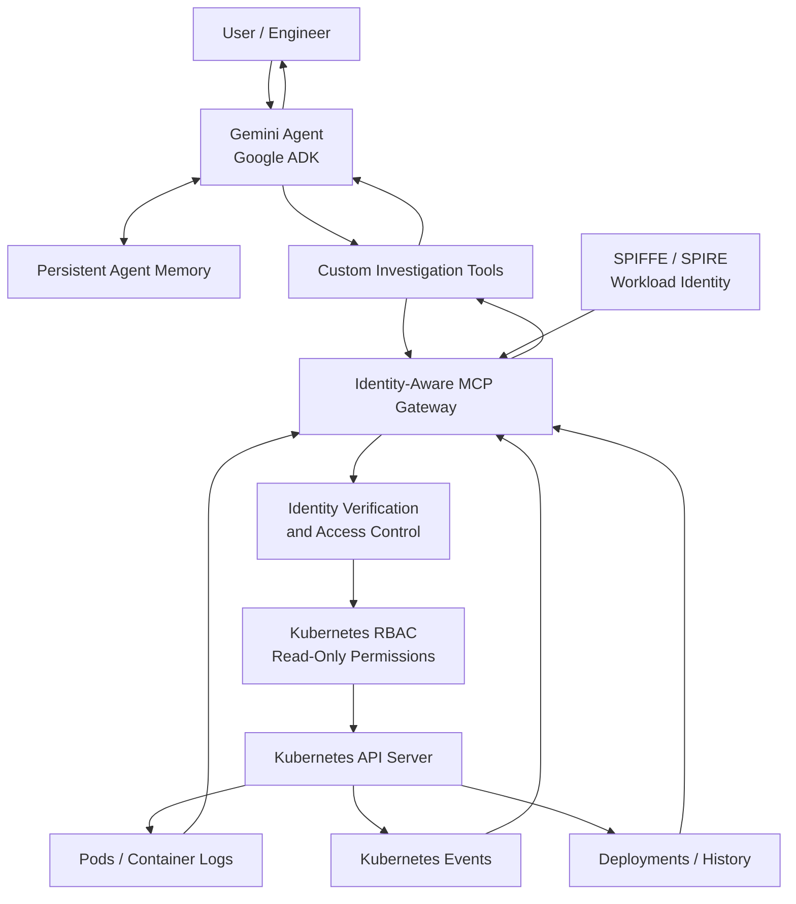

# Kubernetes-Investigation-Agent

**An Identity-Aware Agentic AI System for Secure Kubernetes Investigation and Infrastructure Troubleshooting**

Built with **Google Gemini**, **Google Agent Development Kit (ADK)**, **Model Context Protocol (MCP)**, **Google Kubernetes Engine (GKE)**, **SPIFFE/SPIRE**, and **Kubernetes RBAC**.

---

## Overview

Kubernetes-Investigation-Agent is an AI-powered infrastructure investigation agent designed to help engineers investigate Kubernetes cluster issues through natural-language interactions.

Built using Google's Gemini models and Agent Development Kit (ADK), the agent interprets operational requests, selects relevant investigation tools, retrieves information from Kubernetes resources, and helps provide actionable insights for troubleshooting.

The project combines agentic AI with cloud-native infrastructure and identity-based security. Rather than granting an AI agent unrestricted access to a Kubernetes cluster, the architecture uses a defense-in-depth model that combines workload identity, controlled access mediation, and least-privilege authorization to keep infrastructure investigation secure and auditable.

A persistent memory mechanism enables the agent to retain investigation findings across sessions, supporting continuity when engineers revisit recurring or related infrastructure issues.

### Project Goals

- Enable natural-language investigation of Kubernetes infrastructure.
- Integrate Gemini-powered agentic reasoning with custom Kubernetes tools.
- Deploy the agent and supporting components on Google Kubernetes Engine (GKE).
- Establish workload identity using SPIFFE/SPIRE.
- Mediate agent-to-infrastructure access through an identity-aware MCP gateway.
- Enforce least-privilege access using Kubernetes RBAC.
- Retain investigation context across agent sessions through persistent memory.

---

## System Architecture

The architecture connects the user-facing agent to Kubernetes investigation tools through an identity-aware access path.

### Architecture Components

| Component | Responsibility |
|---|---|
| Google Gemini | Language-model reasoning and request interpretation |
| Google ADK | Agent development and orchestration |
| Custom investigation tools | Retrieve selected Kubernetes resource and diagnostic information |
| MCP gateway | Mediate access between agent tools and Kubernetes infrastructure |
| SPIFFE/SPIRE | Provide workload identity and identity verification |
| Kubernetes RBAC | Enforce authorization and least-privilege permissions |
| GKE | Managed Kubernetes environment |
| Persistent agent memory | Retain and retrieve investigation context across sessions |

---

## Technology Stack

| Category | Technologies |
|---|---|
| Programming Language | Python |
| LLM | Google Gemini |
| Agent Framework | Google Agent Development Kit (ADK) |
| Tool Integration | Model Context Protocol (MCP) |
| Container Orchestration | Kubernetes |
| Cloud Platform | Google Cloud Platform |
| Managed Kubernetes | Google Kubernetes Engine (GKE) |
| Workload Identity | SPIFFE / SPIRE |
| Access Control | Kubernetes RBAC |
| Agent Context | Persistent cross-session memory |

---

## Core Features

### 1. Gemini-Powered Agentic Investigation

The agent uses Google Gemini and ADK to interpret natural-language infrastructure requests and coordinate the relevant investigation workflow.

It can select and invoke purpose-built tools to retrieve Kubernetes information, reducing the need for engineers to manually execute every diagnostic query.

Example investigation requests include:

- Inspect the current state of Kubernetes pods.
- Retrieve logs from a specified pod.
- Examine events associated with a workload.
- Review deployment history.
- Gather relevant cluster information to investigate a reported issue.

### 2. Custom Kubernetes Investigation Tools

Custom tools provide the agent with structured access to selected Kubernetes information.

| Investigation capability | Purpose |
|---|---|
| Pod information | Retrieve pod status and related resource details |
| Pod logs | Retrieve container logs for investigation |
| Pod events | Inspect events associated with a pod |
| Deployment history | Retrieve deployment-related history |

These tools form the operational interface between the agent and the Kubernetes environment. Access is mediated by the project's security architecture and the permissions assigned to the workload.

### 3. SPIFFE/SPIRE Workload Identity

The project implements and tests SPIFFE/SPIRE-based workload identity for agent authentication.

The objective is to associate infrastructure requests with a verifiable workload identity instead of relying on a shared, generic service-account credential.

Key aspects include:

- SPIFFE-based workload identity.
- SPIRE-backed identity issuance and verification.
- Agent workload authentication.
- Identity-aware access to protected infrastructure operations.

### 4. Identity-Aware MCP Gateway

The MCP gateway provides a controlled access layer between the agent's investigation tools and Kubernetes infrastructure.

Its role is to mediate requests and apply the configured identity and access-control checks before infrastructure operations are carried out.

The design focuses on:

- Receiving requests from agent tools.
- Validating workload identity through the configured SPIFFE/SPIRE integration.
- Applying the relevant access-control policies.
- Mediating approved requests to Kubernetes.
- Keeping infrastructure access within the permissions granted to the agent.

### 5. Kubernetes RBAC and Least-Privilege Access

The project uses Kubernetes RBAC to restrict the agent's infrastructure permissions to the operations required for investigation.

The intended access model emphasizes approved read-only diagnostic operations, rather than unrestricted cluster-administration privileges.

The security model covers:

- Restricted access to approved Kubernetes resources.
- Controlled pod and log inspection.
- Access to relevant Kubernetes events.
- Limited deployment-history inspection.
- Authorization through Kubernetes RBAC.

### 6. Persistent Agent Memory

The agent includes persistent memory that retains investigation findings across separate sessions.

This provides continuity when an engineer revisits a previous issue or investigates a related incident.

The memory capability supports:

- Retention of previous investigation findings.
- Retrieval of historical context in later sessions.
- Reuse of relevant troubleshooting information.
- More continuous, context-aware investigation.

---

## Investigation Workflow

The investigation process follows this high-level sequence:

1. **User request:** An engineer submits an infrastructure investigation request in natural language.
2. **Agent reasoning:** Gemini, orchestrated through ADK, interprets the request and determines the relevant investigation steps.
3. **Tool selection:** The agent selects an appropriate custom Kubernetes investigation tool.
4. **Identity verification:** The request passes through the identity-aware MCP gateway and the configured SPIFFE/SPIRE identity-verification flow.
5. **Authorization:** Kubernetes RBAC governs which Kubernetes operations the workload is permitted to perform.
6. **Information retrieval:** Authorized tools retrieve the relevant information from the Kubernetes API.
7. **Contextual investigation:** The agent interprets the returned information and can use relevant findings retained in persistent memory.
8. **Response:** The agent presents the investigation findings to the engineer.

---

## Deployment Environment

The project is deployed on **Google Kubernetes Engine (GKE)**, bringing the agent and its supporting infrastructure into a managed Kubernetes environment.

The deployment brings together:

- Google Cloud Platform and GKE.
- A Gemini-powered agent developed with Google ADK.
- Custom Kubernetes investigation tools.
- MCP-based tool integration.
- SPIFFE/SPIRE workload identity.
- Kubernetes RBAC-based access control.
- Persistent agent memory.

This deployment demonstrates the integration of agentic AI with cloud-native infrastructure and workload identity security.

---

## Security Architecture

Security is a foundational part of the project. The architecture is designed to ensure that an agent's ability to reason about infrastructure does not automatically grant it unrestricted infrastructure access. Instead, access is mediated and constrained using identity verification, controlled tool boundaries, and authorization controls.

| Security concern | Project approach |
|---|---|
| Agent authentication | SPIFFE/SPIRE workload identity |
| Request mediation | Identity-aware MCP gateway |
| Infrastructure authorization | Kubernetes RBAC |
| Permission scope | Least-privilege investigation access |
| Agent context continuity | Persistent investigation memory |

### Security Principles

- **Identity before access:** Requests should be associated with a verifiable workload identity.
- **Least privilege:** The agent should receive only the permissions required for its investigation responsibilities.
- **Controlled tool execution:** Infrastructure access should take place through explicitly defined tools and the configured gateway.
- **Defense in depth:** Workload identity and Kubernetes authorization serve distinct roles in the access-control design.
- **No implicit administrative access:** Agentic reasoning should not be treated as authorization to modify infrastructure.

---

## Testing and Validation

The project includes implementation and testing of its workload-identity integration. The following areas define the key functional and security validation scope.

| Area | Validation focus |
|---|---|
| Agent functionality | Natural-language request handling and agent responses |
| Tool integration | Invocation and response handling for investigation tools |
| Pod investigation | Retrieval of pod information |
| Log retrieval | Access to the intended pod logs |
| Event investigation | Retrieval of relevant Kubernetes events |
| Deployment history | Retrieval of deployment-related information |
| Workload identity | SPIFFE/SPIRE identity issuance and verification |
| Gateway security | Identity-aware request handling |
| Kubernetes RBAC | Enforcement of allowed and denied operations |
| Persistent memory | Retention and retrieval of context across sessions |

**Validation note:** Detailed test commands, evidence, measured results, and screenshots can be added when the corresponding source code and test artifacts are published. No performance or security claims are made beyond the implemented and validated architecture presented here.

---

## Engineering Principles

The project is guided by the following principles:

1. **Identity-aware infrastructure access:** Agent workloads should have verifiable identities.
2. **Least-privilege authorization:** Permissions should be limited to the agent's intended investigation responsibilities.
3. **Explicit tool boundaries:** The agent should interact with infrastructure through defined tools.
4. **Secure-by-design development:** Authentication and authorization should be considered part of the agent architecture.
5. **Persistent context:** Relevant investigation findings should remain available across sessions.
6. **Human-oriented investigation:** The system should help engineers understand infrastructure conditions while keeping access controlled.

---

## Future Enhancements

Potential directions for further development include:

- Multi-agent Kubernetes investigation workflows.
- Correlation of logs, events, and deployment changes.
- More advanced root-cause analysis.
- Integration with Prometheus and Grafana.
- Alert-triggered investigation workflows.
- Structured investigation reports with supporting evidence.
- Human-approved remediation workflows.
- Expanded security auditing and agent activity tracing.
- Enhanced memory retrieval and knowledge organization.

These are prospective enhancements, not claims of currently implemented functionality.

---

## Learning Outcomes

This project brings together practical concepts from several engineering domains:

- Developing and deploying agentic AI applications.
- Building tool-using agents with Google Gemini and ADK.
- Integrating LLM agents with Kubernetes infrastructure.
- Working with MCP-based tool integration.
- Deploying workloads on Google Kubernetes Engine.
- Implementing SPIFFE/SPIRE workload identity.
- Designing identity-aware access-control architectures.
- Applying Kubernetes RBAC and least-privilege principles.
- Implementing persistent memory for cross-session agent context.
- Combining AI engineering, cloud-native infrastructure, and security.

---

## Author

**Bhoopendra Singh Bhadauria**

Computer Science & Engineering | Cloud & DevOps | Agentic AI

- **GitHub:** [GitHub Profile](https://github.com/)
- **LinkedIn:** [LinkedIn Profile](https://www.linkedin.com/)

---

*Exploring the intersection of Agentic AI, Cloud-Native Infrastructure, Kubernetes Operations, and Workload Identity Security.*
